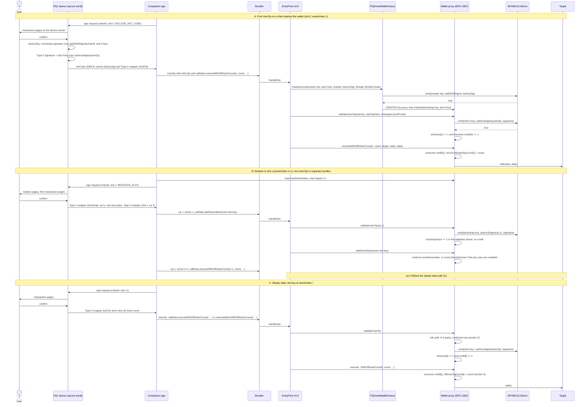
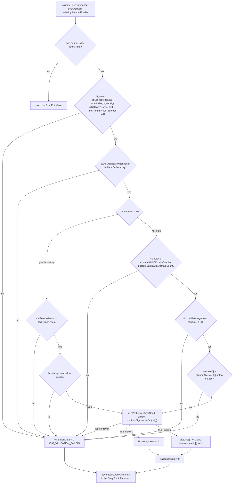
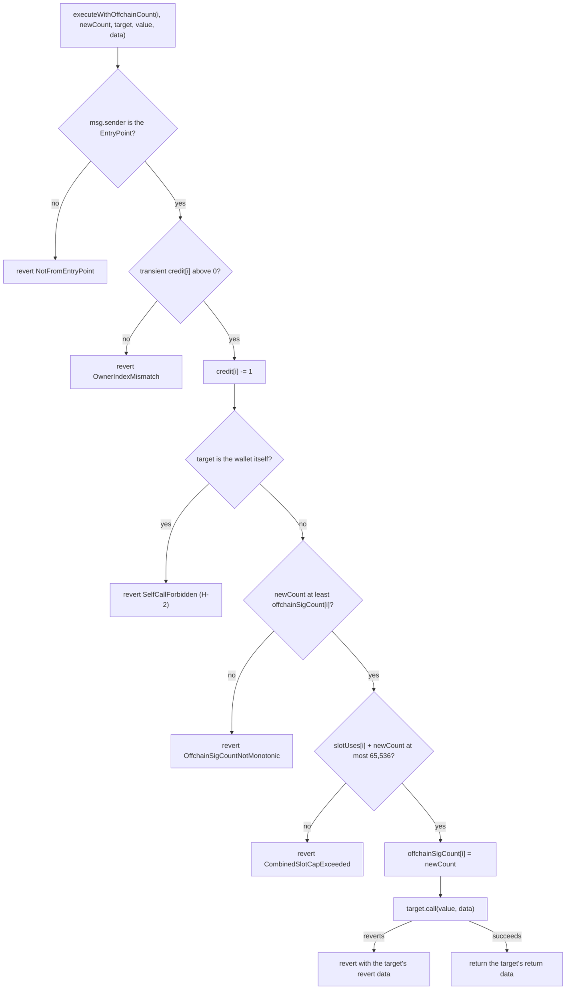
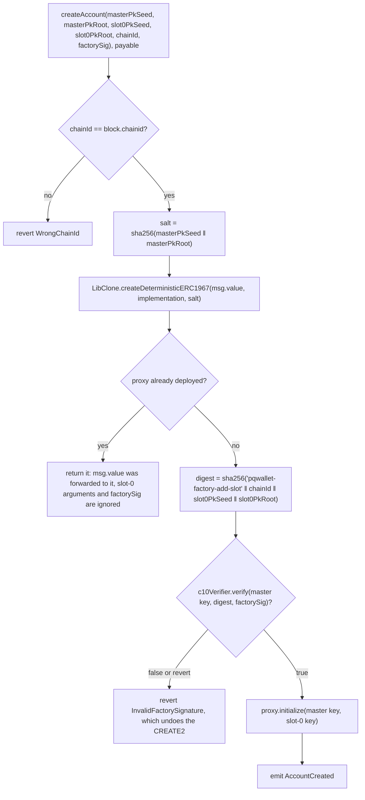
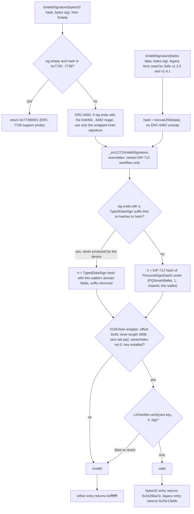
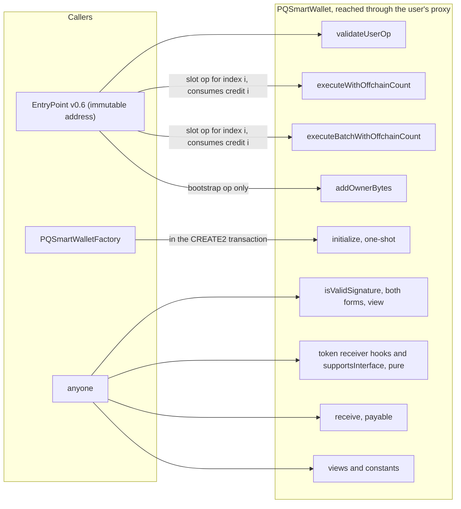

# PQSmartWallet — Diagrams, Actors, Invariants, Glossary

Companion to `AUDIT_SCOPE.md` and `AUDIT_REVIEW_GOALS.md`. Updated
2026-10-20 for the audit freeze. The diagrams are Mermaid; GitHub renders
them, or paste them into `https://mermaid.live`.

Indexing used throughout: the device's slot `s` signs as
`ownerIndex = s + 1`. Index 0 is the bootstrap key.

---

## 1. Lifecycle: deploy, rotate, sign

Notes:
- The factory signature is a bootstrap-key signature, once per chain. It is
  not counted in `bootstrapUses` (`AUDIT_REVIEW_GOALS.md` §4).
- In v0.6, `handleOps` validates every op of a bundle before executing any.
  The transient credit carries "this op was validated for index `i`" from
  one phase to the other (section 3).
- The device signs `sphincsDigest`, a SHA-256 hash, not the EntryPoint's
  keccak `userOpHash` (glossary).

---

## 2. `validateUserOp`

`validationData` never encodes a time range or an aggregator. The counters
are written only after a successful verify, one counter per accepted op.

---

## 3. Execute paths and the transient credit

`executeBatchWithOffchainCount(i, newCount, targets, values, datas)` runs
the same caller, credit and count checks, then requires equal array lengths
(`BatchArrayLengthMismatch`), then for each call rejects the wallet as
target and bubbles any revert.

A revert in execution undoes that execution only: the credit decrement and
the count update roll back. The validation-phase `slotUses[i]` bump stays,
because v0.6 keeps validation state when an op's execution reverts. A
credit left over that way can only be consumed by the EntryPoint, with
calldata that passed validation for index `i`, in the same transaction.

The credit lives at `keccak256(i ‖ _TS_CREDIT_NAMESPACE)` in transient
storage and is a counter, so several ops for one wallet in one bundle each
fund exactly one execution. The bootstrap path uses no credit:
`addOwnerBytes` needs only `msg.sender == entryPoint`, and only a
bootstrap-validated op can carry that selector.

---

## 4. Factory

`getAddress(masterPkSeed, masterPkRoot)` returns
`LibClone.predictDeterministicAddressERC1967(implementation, salt, factory)`.
The device computes the same address from two firmware constants: the
factory address and the proxy init-code hash (`AUDIT_SCOPE.md` §1).

---

## 5. EIP-1271: two entry points, one nested check

Solady's two raw-hash workflows, the MulticallerWithSigner "safe caller"
and the `tx.gasprice == 0` RPC path, are removed by the override (#691).
Both checked the bare hash, and the only bare hashes the device signs are
UserOp `sphincsDigest`s, which are public in on-chain calldata.

The ERC-6492 unwrap only strips the wrapper. Deploying the counterfactual
wallet is the job of the ERC-6492-aware verifier that calls in. The device's
counterfactual blob is `abi.encode(factory, initCode[20:], wrapper) ‖ magic`.

---

## 6. Actors and privileges

| Function | Caller check | Authorised by | Notes |
|---|---|---|---|
| `validateUserOp` | `msg.sender == entryPoint` | the C10 signature in the op | Returns 1 for every signature-shape, role, cap or verify failure. Reverts only for the wrong caller |
| `executeWithOffchainCount` | `msg.sender == entryPoint`, plus one transient credit for `ownerIndex` | slot key `ownerIndex` | Rejects the wallet as target (H-2). Updates `offchainSigCount` monotonically under the combined cap |
| `executeBatchWithOffchainCount` | same | same | Array lengths must match. Self-call check on every target |
| `addOwnerBytes` | `msg.sender == entryPoint` | bootstrap key, through the role split at validation | Appends at `nextOwnerIndex`. Refuses malformed bytes and any key ever installed. Changes no counter |
| `initialize` | none; reverts unless `nextOwnerIndex() == 0` | the factory, after it verified `factorySig` in the same call | The implementation's constructor installs a dummy owner, so `initialize` reverts on the implementation |
| `isValidSignature(bytes32,bytes)` | none (view) | a slot key, over the nested hash | Index 0 rejected. ERC-6492 unwrap. ERC-7739 probe |
| `isValidSignature(bytes,bytes)` | none (view) | the same, over `keccak256(data)` | No ERC-6492 unwrap |
| `onERC721Received`, `onERC1155Received`, `onERC1155BatchReceived`, `supportsInterface` | none (pure) | none | Always accept. No state. `supportsInterface` is true for `0x01ffc9a7`, `0x150b7a02`, `0x4e2312e0` only |
| `receive()` | none | none | Accepts ETH. There is no fallback, so unknown selectors revert |
| Views (`entryPoint`, `c10Verifier`, `ownerAtIndex`, `nextOwnerIndex`, `ownerCount`, `isOwnerBytes`, counters, `masterPkSeed`, `masterPkRoot`, `sphincsDigest`, `eip712Domain`, constants) | none | none | Read only |
| Factory `createAccount` | none (payable) | bootstrap signature over the slot-0 digest, first deployment only | Already deployed: forwards `msg.value`, ignores the rest |
| Factory `getAddress`, `addSlot0Digest` | none | none | View / pure |

### Roles

- **Bootstrap key (`ownerIndex == 0`).** Signs only `addOwnerBytes`
  UserOps, plus the factory's slot-0 authorisation once per chain. Never
  accepted by EIP-1271. Nothing can remove or replace it. Cap:
  `bootstrapUses ≤ 65,536` per chain.
- **Slot keys (`ownerIndex ≥ 1`).** Sign only the two execute selectors,
  for their own index, and off-chain messages (nested hash only). Cap:
  `slotUses[i] + offchainSigCount[i] ≤ 65,536` per chain.
- **Factory.** Its only power over a wallet is the atomic `initialize`. It
  has no admin; `implementation` and `c10Verifier` are immutable.
- **EntryPoint.** Trusted to run v0.6 `handleOps` semantics: validate, then
  execute the validated `callData`.
- There is no admin, guardian, pause, upgrade or recovery role anywhere.

---

## 7. Invariants

Where an invariant is checked mechanically, the check is named. Lean
theorem names are under `contracts/verification/lean/SphincsCVerify/Wallet/`.

### Storage (always)

| ID | Invariant | Enforced by | Checked by |
|---|---|---|---|
| S-1 | `ownerAtIndex[0]` is set on every initialised proxy and never changes | `initialize` is one-shot; `addOwnerBytes` appends at `nextOwnerIndex ≥ 2`; there is no removal | Over a run: fuzz `invariant_owner_set_append_only` (every index, 0 included, keeps its key). Per step: Lean `cannot_remove_bootstrap` (one `addOwner` step on an initialised state leaves index 0 unchanged) plus the closed-world mutator gate `verify-storage-mutators`; Kontrol `KontrolBootstrapUnremovable` |
| S-2 | Every installed owner is 64 bytes | `InvalidOwnerBytesLength` | Halmos `HalmosMultiOwnable` |
| S-3 | Owner keys use the N-mask layout: the low 16 bytes of `pkSeed` and of `pkRoot` are zero | `InvalidNMaskLayout` | unit tests |
| S-4 | `bootstrapUses` is monotonic and `≤ 65,536` | validation pre-check; `_bumpBootstrapUses` `require` | fuzz `invariant_bootstrapUses_capped`, `invariant_bootstrapUses_monotonic`; Lean `no_reset_path` (per operation); Halmos `check_bootstrap_bumps_cap_at_validation` |
| S-5 | For every `i`: `slotUses[i] + offchainSigCount[i] ≤ 65,536` | validation pre-check (`< 65,536` before the bump); `_setOffchainSigCount` (`CombinedSlotCapExceeded`) | fuzz invariants; Lean `reachable_implies_combinedCap` |
| S-6 | `slotUses[i]` and `offchainSigCount[i]` never decrease | increment only; `OffchainSigCountNotMonotonic` | fuzz invariants; Lean `no_reset_path` |
| S-7 | The owner set is append-only: `nextOwnerIndex` only grows, `ownerAtIndex[k]` for `k < nextOwnerIndex` never changes, and `isOwner` never goes back to false | no removal path | Over time: fuzz `invariant_owner_set_append_only`. Per state: Lean `reachable_ownerTableWF` (on every reachable state the table is injective and every installed key is flagged and below `nextOwnerIndex`) |
| S-8 | A key is installed at most once in a wallet's life, so its counters can never be reset by re-installing it | `AlreadyOwner` | `test_installedKeyCanNeverBeInstalledAgain`; Lean `reachable_key_installed_at_most_once` |
| S-9 | The reserved field `removedOwnersCount` is always zero, and `ownerCount() == nextOwnerIndex()` | no code writes the field; `ownerCount()` returns `nextOwnerIndex` | Source inspection; Halmos `HalmosMultiOwnable` checks that `addOwnerBytes` and the removed selector leave the reserved slot unchanged |
| S-10 | `entryPoint` and `c10Verifier` (wallet) and `implementation` and `c10Verifier` (factory) never change | `immutable` | codehash pins |
| S-11 | The ERC-7201 storage location is `0x470749eea5ac4a541d6582e535445f94e7300bac9e0e4e5577fd3336b407d000` | constant | `StorageSlotParity.t.sol` |
| S-12 | A proxy's ERC-1967 implementation slot never changes | no upgrade function | `invariant_impl_slot_unchanged` |

### Transient (within one transaction)

| ID | Invariant | Enforced by |
|---|---|---|
| T-1 | Each slot op validated for index `i` adds exactly one credit for `i` | `_stampValidatedCredit`, after a successful verify only |
| T-2 | An execute for index `i` runs only if a credit for `i` exists, and consumes exactly one | `_consumeValidatedCredit`, `OwnerIndexMismatch` |
| T-3 | A credit for `i` is stamped only by an op whose calldata names `i`, so it cannot fund another index | H-3 parity at validation |
| T-4 | The bootstrap path stamps no credit | `_validateSignature` |
| T-5 | Credits are gone at the end of the transaction | EIP-1153 |

### Validation (per call)

| ID | Invariant |
|---|---|
| V-1 | An op validated under index 0 calls `addOwnerBytes` and nothing else |
| V-2 | An op validated under index `i ≥ 1` calls `executeWithOffchainCount` or `executeBatchWithOffchainCount` with first argument `i` |
| V-3 | The signed message is `sphincsDigest(userOp)`, which binds `block.chainid` and the EntryPoint address. `userOpHash` is ignored |
| V-4 | A wrapper that is not exactly 4128 bytes, has an offset other than `0x40`, an inner length other than 4008, or a non-zero tail pad fails |
| V-5 | A malformed or wrong signature returns 1 and never reverts. The only revert is `NotFromEntryPoint` (the counters' `require`s are unreachable because the caps are checked first) |
| V-6 | A verifier that returns false or reverts gives 1 |
| V-7 | Counters change only after a successful verify, one counter per accepted op |

The Halmos rules `HalmosValidateUserOpEquiv` and `HalmosExecuteEquiv` check
the compiled bytecode against the Lean model of these paths, point by point.

### Off-chain signatures

| ID | Invariant |
|---|---|
| E-1 | Both EIP-1271 entries accept only a signature over one of Solady's two nested EIP-712 forms, each bound to `("PQSmartWallet", "1", block.chainid, address(this))`: `PersonalSign` (the only form the device signs) and `TypedDataSign` (the wallet's domain fields inside a struct under the app's domain) |
| E-2 | Index 0 is never accepted off-chain |
| E-3 | EIP-1271 changes no state |
| E-4 | The legacy entry returns `0x20c13b0b` exactly when the `bytes32` entry returns `0x1626ba7e` for `keccak256(data)` and the same signature without an ERC-6492 wrapper. By construction (both call `_erc1271IsValidSignature`); Halmos `check_legacy_isValidSignature_agrees_with_bytes32_entry` checks one instance class (66-byte `data`, `ownerIndex` 1, symbolic verifier answer), and `LegacyERC1271.t.sol` exercises real paths |

### Addresses

| ID | Invariant |
|---|---|
| A-1 | `salt = sha256(masterPkSeed ‖ masterPkRoot)` |
| A-2 | The same master key gives the same proxy address on every chain where this exact contract set is deployed at the same addresses |
| A-3 | The first deployment requires a bootstrap signature over `sha256("pqwallet-factory-add-slot" ‖ chainId ‖ slot0PkSeed ‖ slot0PkRoot)` |
| A-4 | `createAccount` requires `chainId == block.chainid` |
| A-5 | The production build's factory address and proxy init-code hash equal the firmware constants (CI: `DeployedBytecodeReproCheck`, deploy profile) |

---

## 8. Glossary

| Term | Meaning |
|---|---|
| **SPHINCS+** | A stateless hash-based signature design, standardised by NIST as SLH-DSA (FIPS 205). Its security rests on properties of the hash function, SHA-256 here, with no number-theoretic assumption. |
| **SPHINCS+C10** | The parameter set used here: a SPHINCS+ variant with the "C" (grinding) optimisations, `h=18, d=2, a=11, k=13, w=8, l=43, target_sum=205`. Signatures are 4,008 bytes. It is not one of the FIPS 205 parameter sets. The hypertree has 2^18 leaves; the contracts cap each key at 65,536 signatures per chain. |
| **Bootstrap key** | The wallet's root C10 key at `ownerIndex 0`. Fixed at deployment. Signs only `addOwnerBytes` and the factory's slot-0 authorisation. The wallet address derives from it. |
| **Slot key** | A C10 key at `ownerIndex ≥ 1`. Device slot `s` signs as `ownerIndex s+1`. Slot keys differ per chain. Rotating means adding a new slot; old slots stay installed. |
| **N-mask layout** | A 32-byte word holding a 16-byte value in its top half, with the low 16 bytes zero. C10 has `n = 16`; the verifier and the EVM work in 32-byte words. |
| **`pkSeed`, `pkRoot`** | The two halves of a C10 public key, each in the N-mask layout. Together they are the 64 owner bytes. |
| **ERC-4337 v0.6** | The account-abstraction version targeted. Frozen: its EntryPoint address is part of every signed digest and of the wallet address derivation. |
| **UserOp** | A v0.6 UserOperation: `sender, nonce, initCode, callData, callGasLimit, verificationGasLimit, preVerificationGas, maxFeePerGas, maxPriorityFeePerGas, paymasterAndData, signature`. |
| **`sphincsDigest`** | The SHA-256 hash the device signs for a UserOp: `sha256(sender ‖ nonce ‖ sha256(initCode) ‖ sha256(callData) ‖ the five gas words ‖ sha256(paymasterAndData) ‖ entryPoint ‖ chainId)`. Used instead of the keccak `userOpHash` because the device has a SHA-256 accelerator and no keccak hardware. |
| **Signature wrapper** | `abi.encode(uint256 ownerIndex, bytes c10Sig)`, exactly 4,128 bytes. Used for UserOps and for EIP-1271. |
| **Type-1 signature** | A bootstrap-key signature on a UserOp, which can only call `addOwnerBytes`. Counts against `bootstrapUses`. |
| **Type-2 signature** | A slot-key signature on a UserOp, which can only call one of the two execute selectors. Counts against `slotUses[i]`. |
| **`bootstrapUses`** | Per-chain count of accepted Type-1 signatures, bumped in the validation phase. Cap 65,536. |
| **`slotUses[i]`** | Per-chain count of accepted Type-2 signatures for index `i`, bumped in the validation phase. |
| **`offchainSigCount[i]`** | The number of off-chain signatures the device reports having made with key `i`, carried by every execute call. Monotonic. |
| **Combined cap** | `slotUses[i] + offchainSigCount[i] ≤ 65,536`: UserOps and off-chain signatures share one budget per key and chain. |
| **Transient credit** | An EIP-1153 counter per `ownerIndex` that validation increments and execution decrements, so that one validated op buys at most one execution. |
| **H-2, H-3, M-1, L-1, L-2, L-3** | Finding IDs from the internal review `AUDIT_2026-05-18.md`. H-2: no self-calls from execute. H-3: calldata index equals signing index. M-1: the bootstrap count, now done in validation. L-1: zero tail pad. L-2: `_erc1271Signer` tripwire. L-3: custom batch error. |
| **EIP-1271** | `isValidSignature(bytes32, bytes)` returning `0x1626ba7e`. The legacy form `isValidSignature(bytes, bytes)` returns `0x20c13b0b`. |
| **Nested EIP-712 (ERC-7739)** | Solady's scheme that wraps the dapp's hash in a typed structure under this wallet's domain (`name "PQSmartWallet"`, `version "1"`, chain id, wallet address), so a signature verifies for one wallet on one chain only. The device uses the `PersonalSign` form. |
| **ERC-6492** | A wrapper that lets a not-yet-deployed wallet's signature be checked: `abi.encode(factory, factoryCalldata, signature) ‖ 0x6492…6492`. The verifier deploys the wallet, then calls `isValidSignature`. |
| **ERC-7201** | Namespaced storage. The wallet's state lives in one struct at the slot derived from `pqsigner.storage.PQMultiOwnable`. |
| **ERC-1967 proxy** | The 61-byte per-user contract the factory deploys. It delegates every call to the shared implementation. |
| **Squat defence** | The factory's requirement of a bootstrap signature over the slot-0 key and chain id. Without it, anyone who knows a master public key could deploy the victim's address with their own slot 0. |
| **Arachnid deployer** | The deterministic CREATE2 deployer at `0x4e59b44847b379578588920cA78FbF26c0B4956C`, used with salt 0 so the contract addresses are the same on every chain. |
| **Halmos, Kontrol** | Symbolic-execution tools run on the compiled bytecode: Halmos on Foundry `check_*` harnesses (`test/halmos/`), Kontrol (KEVM) on `prove_*` harnesses (`../verification/kontrol/`). |
| **PQ1** | The hardware wallet: an STM32U585 microcontroller with two secure elements. It holds the seed and produces every signature these contracts verify. |
